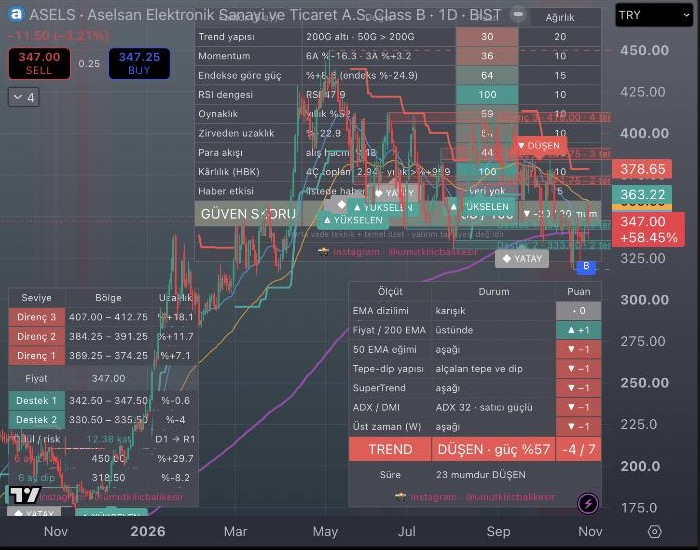

# BIST TradingView Göstergeleri (ücretsiz Pine Script)

**Borsa İstanbul (BIST) hisseleri için 3 ücretsiz TradingView göstergesi:** otomatik destek/direnç, 7 ölçütlü trend yönü ve 0–100 güven skoru (bilanço, temettü, bölünme, haber işaretleriyle).
Pine Script v6 ile yazıldı, açık kaynak, kopyala-yapıştır ile 1 dakikada kurulur.

Hazırlayan: **Instagram [@umutkilicbalikesir](https://www.instagram.com/umutkilicbalikesir/)**

> Yatırım tavsiyesi değildir. Göstergeler bilgi amaçlıdır; geçmişe dönük getiri testi yapılmamıştır. Al/sat kararı vermez.

---

## Göstergeler

| Gösterge | Ne yapar | Dosya |
|---|---|---|
| **UK · Otomatik Destek / Direnç** | Son 6 ayın tepe ve diplerini ATR'ye göre bölgelere toplar, en az 2 kez test edilmiş en yakın 3 destek ve 3 direnci kutu olarak çizer. Tabloda uzaklık (%), ödül/risk oranı, 6 ay zirve/dip. Kırılımda alarm. | [`scripts/destek-direnc.pine`](scripts/destek-direnc.pine) |
| **UK · Trend Yönü** | 7 ölçütle (EMA dizilimi, 200 EMA, 50 EMA eğimi, tepe-dip yapısı, SuperTrend, ADX/DMI, haftalık trend) puan verir: YÜKSELEN / DÜŞEN / YATAY. Trendin kaç mumdur sürdüğünü gösterir, değişimde alarm. | [`scripts/trend-yonu.pine`](scripts/trend-yonu.pine) |
| **UK · Güven Skoru + Şirket Olayları** | 9 faktörlü 0–100 orta vade skoru (trend, momentum, XU100'e göre güç, RSI, oynaklık, zirveden uzaklık, para akışı, HBK kârlılığı, haber). Grafikte bilanço (B), temettü (T), bölünme/bedelsiz (S) ve kendi girdiğin haber (H) işaretleri; olay sonrası fiyat ve hacim tepkisi. | [`scripts/guven-skoru-sirket-olaylari.pine`](scripts/guven-skoru-sirket-olaylari.pine) |

## Kurulum (TradingView, ücretsiz hesap yeterli)

1. TradingView'de bir grafik aç (ör. `BIST:ASELS`, günlük).
2. Alttaki **Pine Editor** sekmesini aç.
3. Sol üstteki menüden **Create new → Indicator** seç, içindeki kodu tamamen sil.
4. Bu depodaki `.pine` dosyasını aç, **Raw** düğmesine bas, tamamını kopyala ve editöre yapıştır.
5. **Save** (Kaydet) → **Add to chart** (Grafiğe ekle).
6. Diğer iki gösterge için 3–5. adımları tekrarla. Kaydettikten sonra hepsi **Indicators → My scripts (Kişisel)** altında durur; göz simgesiyle açıp kapatabilirsin.

**İpucu:** Tablolar varsayılan olarak farklı köşelerde: Güven sağ üst, Destek/Direnç sol alt, Trend sağ alt. Konumları her göstergenin ayarlarından değişir.

## Sık sorulan sorular

**BIST hisseleri için ücretsiz destek direnç göstergesi var mı?**
Evet. `UK · Otomatik Destek / Direnç` seviyeleri elle çizmeden, son 6 ayın tepe ve diplerinden otomatik bulur. Bölge kalınlığı ATR'ye göre ayarlandığı için her zaman diliminde çalışır.

**TradingView'de bir hissenin trendinin yükselen mi düşen mi olduğunu tek bakışta nasıl görürüm?**
`UK · Trend Yönü` 7 bağımsız ölçütü +1 / 0 / −1 olarak puanlar ve toplamı tabloda gösterir (ör. "DÜŞEN · −4/7"). Arka plan trend rengine boyanır.

**BIST'te hacim neden görünmüyor / para akışı neden boş?**
TradingView'in `BIST:` (ve `BISTMIXED:`) akışında hacim verisi yok. Güven Skoru hacmi otomatik olarak 15 dk gecikmeli `BIST_DLY:` akışından alır; ayarlardaki "BIST hacim öneki" ile değiştirilebilir.

**Bilanço, temettü ve bedelsiz tarihlerini grafikte görebilir miyim?**
Evet. Güven Skoru göstergesi bunları TradingView verisinden otomatik işaretler; işaretin üstüne gelince olaydan sonraki fiyat ve hacim tepkisi yazar. KAP haberlerini "Haber listesi" kutusuna `HİSSE | TARİH | + / - / 0 | BAŞLIK` biçiminde ekleyebilirsin.

**Ücretli mi?**
Hayır. Kod açık kaynaktır (MIT lisansı), ücretsiz TradingView hesabında çalışır.

**Al/sat sinyali veriyor mu?**
Hayır. Göstergeler bilgi verir, karar vermez. Yatırım tavsiyesi değildir.

## Teknik notlar

- Pine Script **v6**. Gelecek veriye bakmaz: üst zaman dilimi önceki kapanmış mumdan alınır, tepe/dipler oluştuktan sonra kullanılır.
- Güven Skoru'ndaki tüm faktörler **günlük** veriden hesaplanır. Kârlılık (HBK) puanı grafikte yüklü geçmişe bağlıdır; en sağlıklı okuma günlük grafiktir.
- Trend alarmlarını TradingView'de **"Once per bar close"** ile kur (mum kapanmadan puan değişebilir). Destek/Direnç kırılım alarmı için koşul olarak **"Any alert() function call"** seç.

---

## English summary

**Free TradingView indicators for Borsa Istanbul (BIST) stocks**, written in Pine Script v6:

- **Auto Support / Resistance** – clusters 6-month swing highs/lows into ATR-sized zones, draws the nearest tested zones, reward/risk ratio, breakout alerts.
- **Trend Direction** – 7-factor score (EMA stack, 200 EMA, 50 EMA slope, swing structure, SuperTrend, ADX/DMI, weekly trend) → UP / DOWN / SIDEWAYS, with trend duration.
- **Confidence Score + Corporate Events** – 0–100 mid-term score from 9 daily factors, plus earnings / dividend / split / custom-news markers with post-event price and volume reaction. Volume for BIST is read from the `BIST_DLY:` feed.

Install: open Pine Editor → new indicator → paste the `.pine` file → Save → Add to chart. Not investment advice.

Made by Instagram **[@umutkilicbalikesir](https://www.instagram.com/umutkilicbalikesir/)** · MIT License

**Anahtar kelimeler:** BIST TradingView göstergesi, Pine Script BIST, Borsa İstanbul destek direnç göstergesi, trend göstergesi, hisse güven skoru, TradingView indikatör ücretsiz, bilanço temettü bedelsiz işareti, BIST_DLY hacim.
